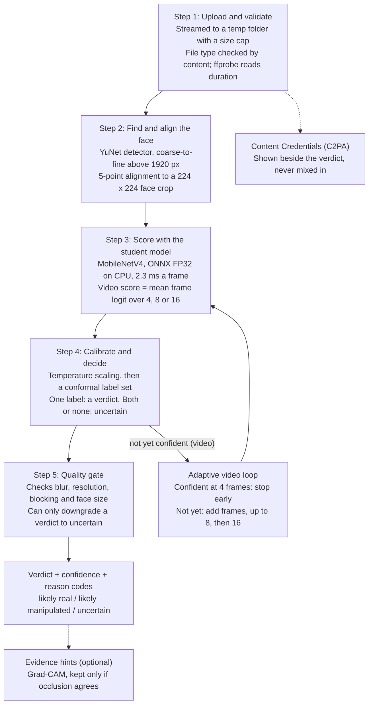

# ConfiGuard-Lite: Project Overview

As of 2026-11-10.

## 1. Overview

ConfiGuard-Lite is a deepfake detector for face images and videos. It is
small enough to train on a 6 GB laptop GPU and to run on a CPU-only server.
It answers with one of three verdicts: **likely real**, **likely
manipulated**, or **uncertain**. It says "uncertain" rather than guess when
the evidence is weak.

The core is a 2.49M-parameter MobileNetV4 model (9.5 MiB as ONNX). It learned
from a 304M-parameter CLIP "teacher" through knowledge distillation. On
FaceForensics++ validation videos it scores **0.974 video AUROC**. A video
verdict takes about 6 frames on average, and the model itself runs in
**8.8 ms** on CPU.

- **Built for:** journalists, moderators and researchers who need a quick,
  honest second opinion, not a forensic certificate.
- **Hardware target:** Windows laptop, Ryzen 7000 CPU, NVIDIA RTX 4050 Laptop
  GPU (6 GB VRAM). It deploys on CPU, with optional NVIDIA GPU.
- **What sets it apart:** it is uncertainty-aware, it degrades safely on
  low-quality media, and it reports Content Credentials (C2PA) provenance as
  a separate signal, never mixed into the score.
- **Scope:** results are validated on FaceForensics++ c23 development data
  only. The test split is still sealed, and every answer carries a "not
  proof" notice.

## 2. How it works end to end

An upload goes through five stages. Every stage after scoring can only make
the answer more cautious. Images run each stage once on a single face crop.
Videos sample 16 evenly spaced frame positions but score only as many as
needed.



Solid arrows are the decision path. Dashed arrows are side outputs that never
change the verdict. A typical FF++ video is decided in about 0.5–1 s end to
end.

Plain-text version of the same flow:

```
Upload -> Validate -> Face detect + align -> Student model (ONNX)
       -> Calibration + conformal set -> Quality gate -> Verdict
                 ^                 |
                 +-- add frames ---+   (video only: 4 -> 8 -> 16 frames)

Side outputs (never change the verdict): C2PA provenance, evidence heatmaps
```

## 3. Tech stack and why each piece was chosen

Every choice serves two limits: training must fit 6 GB of VRAM, and serving
must run on a plain CPU server. So PyTorch is used for training only. The
deployed service runs ONNX Runtime and never imports PyTorch.

| Layer | Technology | What it does here | Why this one |
| --- | --- | --- | --- |
| Language | Python 3.11 | All ML, data and service code | The ML stack (PyTorch, timm, ONNX Runtime) supports it fully. 3.14 is not yet supported. |
| Training | PyTorch 2.5.1 + CUDA 12.1, fp16 AMP | Trains the student on the RTX 4050 | Mixed precision and gradient accumulation keep peak VRAM tiny: 154 MB at batch 8. |
| Model zoo | timm | Supplies the MobileNetV4-Conv-Small and EfficientNet-B0 backbones | Pinned, ImageNet-pretrained weights with a uniform API, so the two models can be swapped and compared fairly. |
| Teacher | Hugging Face Transformers + GenD CLIP-L/14 | Frozen teacher that produces soft labels once, offline | Its forgery knowledge transfers to a model 120x smaller. It is never trained here, so it fits the laptop. |
| Face detection | OpenCV YuNet (ONNX) | Finds faces and 5 landmarks per frame | Fast on CPU and needs no PyTorch. The model file is pinned by SHA-256. |
| Media | OpenCV, FFmpeg / ffprobe | Decodes video frames, reads duration and frame counts | ffprobe gives reliable metadata for variable-frame-rate and rotated video. OpenCV decodes the pixels. |
| Inference runtime | ONNX Runtime (CPU, optional CUDA) | Runs the exported student in production | 2.3 ms per frame on CPU, no PyTorch on the server, and the same file serves CPU and GPU. |
| Model formats | ONNX FP32 / FP16 / INT8 | Deployment variants | FP32 (9.5 MiB) is the default. FP16 is equally accurate but not faster here. INT8 is not used because its agreement was lower. |
| Statistics | NumPy | Temperature scaling, conformal prediction, quality signals | Small, auditable math with no extra dependencies. |
| API | FastAPI + Uvicorn | `/v1/analyze`, health checks, OpenAPI docs | Async streaming uploads, typed schemas and automatic API docs. |
| Provenance | c2pa-python (official CAI SDK) | Reads and verifies Content Credentials | It is the reference implementation, checked against the official C2PA Trust List. |
| Config | YAML + dataclasses, `.env` | Per-environment settings and paths | Fewer dependencies than pydantic. Machine paths and secrets stay out of the code. |
| Frontend | React 19, TypeScript, Vite, Tailwind CSS 4 | Landing page, detector UI and about page | A typed, fast build. Its output is served by the same FastAPI process, so there is no CORS. |
| 3D hero | three.js + a CC0 MakeHuman head | Animated landing visual | Loaded lazily, with a poster image fallback when WebGL is unavailable. |
| Quality tools | pytest, Vitest, Testing Library, Playwright, axe-core, Lighthouse, Biome | 715 Python tests, 82 unit tests, end-to-end, accessibility and performance checks | Each layer is tested where it lives. |
| Packaging | Docker (multi-stage), Compose | Hardened image `configuard-lite:1.0.0-rc.1` | Runs as a non-root user with a read-only filesystem, all Linux capabilities dropped and a health check. |
| Hosting | Oracle Cloud Always Free (Ampere arm64) + Caddy | Public HTTPS deployment | Free with enough RAM (about 1 GiB peak). Caddy handles automatic HTTPS and caps upload size. |

## 4. Models and training

The shipped model is `student_distilled_p80`. It is a MobileNetV4-Conv-Small
student that learned from a frozen GenD CLIP-L/14 teacher on FaceForensics++
c23 face crops. It reaches about the teacher's video AUROC (0.974 vs 0.979)
at 1/120th of the size.

| Model | Role | Parameters | Val video AUROC | Notes |
| --- | --- | --- | --- | --- |
| GenD CLIP-L/14 | Frozen offline teacher | 303.97M | 0.979 | MIT license. Only its logits are cached, and it never ships. |
| MobileNetV4-Conv-Small, distilled | **Production student** | 2.49M | 0.974 (calibrated) | Frame ECE 0.033 vs 0.071 for the baseline, so its probabilities are more honest. |
| MobileNetV4-Conv-Small, BCE only | Training baseline | 2.49M | 0.981 | Slightly higher AUROC but badly calibrated (frame NLL 0.504 vs 0.216). |
| EfficientNet-B0 | Comparison baseline | 4.01M | — | About 2x slower on CPU (99.8 vs 46.7 ms P50 for the backbone). |

**Data.** The model was trained on FaceForensics++ c23: 5,000 videos
(8.4 GiB) on drive D:. They cover four manipulation methods: Deepfakes,
Face2Face, FaceSwap and NeuralTextures. The authors' official split is used
(720/140/140 original videos). From these, 79,280 aligned 224×224 face crops
were extracted, 16 per video, with real and fake crops matched by frame
index. Families that leak across splits were quarantined, and the test split
is sealed.

**Distillation.** The loss is `(1−α)·BCE + α·T²·BCE(σ(z/T), σ(m/T))` with
α = 0.5 and T = 2. Here m is the teacher's margin (logit_fake − logit_real).
The student copies the teacher's confidence as well as its answers, which is
where the better calibration comes from.

**Training on 6 GB.** Training uses fp16 mixed precision, AdamW with a
warm-up cosine schedule, gradient clipping, and cached face crops so no
decoding happens during training. Seeds are deterministic, and training can
resume from any epoch.

Experiments that were tried and rejected, each with a recorded decision:

- **Compression-robust training (6e):** the worst-case stress AUROC rose
  from 0.692 to 0.825, but clean AUROC fell to 0.927, so this model was not
  shipped.
- **GRU temporal head (7):** a 157k-parameter GRU over frame embeddings gained
  +0.0014 AUROC, a confidence interval that includes zero. Video scoring
  stays as the mean frame logit.
- **INT8 export (8):** 2.7 MiB, but uncalibrated and with lower agreement,
  so it is not used.

## 5. The trust layer: knowing when not to answer

A raw score is not a verdict. Four layers sit around the model. Each one can
only make the answer more cautious; none of them can flip real to fake.

1. **Calibration (temperature scaling).** This rescales the logit so that a
   stated 90% means right about 90% of the time. Video ECE dropped from
   0.043 to 0.035. Single images and videos are calibrated separately.
2. **Conformal prediction gives the "uncertain" verdict.** Mondrian split
   conformal (α = 0.05) builds a set of plausible labels. One label gives a
   verdict. Both labels, or none, gives **uncertain** with a reason code. On
   validation, 5.8% of videos were uncertain, only 2.2% of real videos were
   called manipulated, and 92.2% of decided videos were correct.
3. **Media-quality gate.** Sharpness, effective resolution, blocking and face
   size are measured on every crop. Poor quality turns a confident verdict
   into uncertain, for example `LOW_SHARPNESS` or `SMALL_FACE`. On heavily
   blurred real videos (blur σ 2), false accusations fell from 84% to 0%.
4. **Evidence hints (explanations).** Optional Grad-CAM heatmaps on the face
   crop show where the score came from. A hint is shown only if an occlusion
   check confirms it; otherwise an occlusion map is tried, and if that also
   fails, nothing is shown. About half are withheld. Hints are labelled "not
   proof" and never change the verdict.

**Content Credentials (C2PA) is a separate signal.** If a file carries a
C2PA manifest, the official CAI SDK verifies it against the official C2PA
Trust List. It reports who signed the file and what they declared. This
status is shown next to the model's verdict, never merged into it. Most files
have no credentials, and that says nothing about manipulation.

## 6. Service, website and deployment

One FastAPI process serves both the API and the React website. It runs the
ONNX model on CPU and ships as a hardened Docker image.

**API (`src/configuard/service/`)**

- `POST /v1/analyze` takes one image or video. `GET /v1/limits` returns
  upload limits. `GET /health/live` and `GET /health/ready` report health.
  OpenAPI docs are served at `/docs`.
- **Upload safety:** uploads are streamed to a per-request temporary folder
  with a byte cap. The file type is checked by its content (magic bytes)
  against its extension, and video duration is checked with ffprobe. The
  temporary files are deleted after every request.
- **Load control:** a bounded worker pool and queue return `503 server_busy`
  instead of falling over. A per-request deadline returns `504`.
- **Integrity:** readiness requires every model artifact to match its
  SHA-256, re-checked every 30 s. Production refuses to start without API
  keys.
- **Privacy:** logs are structured JSON with request IDs and never contain
  file names. Uploads are never kept.
- **Limits (dev):** images up to 20 MB, videos up to 200 MB and 120 s.
  Accepted types are .jpg .jpeg .png .webp .mp4 .mov .mkv .avi.

**Website (`frontend/`)**

- **Pages:** `/` is the landing page, `/detect` the detector, and `/about`
  covers the method, evaluation and limits.
- **Built with:** React 19 and TypeScript, built by Vite, styled with
  Tailwind 4 and self-hosted fonts. It loads nothing from other domains, and
  a strict Content Security Policy blocks inline scripts.
- **Detector page:** shows upload progress, the verdict with its confidence,
  the evidence timeline for videos, heatmap hints and a separate Content
  Credentials card.
- **Accessibility and themes:** light, dark and system themes, reduced-motion
  support, and axe-core accessibility tests.

**Deployment**

- **Docker image `1.0.0-rc.1`:** multi-stage build with hash-locked Python
  dependencies and digest-pinned base images. It runs as uid 10001 with a
  read-only filesystem, all capabilities dropped, and writes only to `/tmp`.
  A release manifest records the SHA-256 of every file.
- **Hosting (Phase 15):** Oracle Cloud Always Free (Ampere A1, arm64) behind
  Caddy, which provides automatic HTTPS, HSTS and a 160 MB body cap. The
  bundle and arm64 image were verified locally; the VM has not been created
  yet.

**Running it locally**

```powershell
# Backend (from the project root, venv activated)
python scripts\serve.py --env development      # http://127.0.0.1:8000

# Frontend with hot reload (optional, second terminal)
cd frontend
npm ci                                          # first time only
npm run dev                                     # http://127.0.0.1:5173
```

## 7. How it differs from other deepfake detectors

Most deepfake projects chase a higher accuracy number with a bigger model and
always output a fake-or-real label. ConfiGuard-Lite instead aims for
near-teacher accuracy at laptop scale, admits when it does not know, and
ships as a hardened service. The comparison below describes typical project
types from general knowledge, not measured rivals.

| Aspect | Typical student / Kaggle project | Large research model (CLIP or ViT based) | ConfiGuard-Lite |
| --- | --- | --- | --- |
| Model size | Xception or EfficientNet, 20–80M params | 300M+ params, needs a big GPU | 2.49M params, 9.5 MiB ONNX |
| Runs on | GPU notebook | Data-centre GPU | Plain CPU server; GPU optional |
| Output | Fake or real, always | A score | Likely real, likely manipulated, or **uncertain** with a reason |
| Probabilities | Uncalibrated | Rarely calibrated | Temperature-scaled + conformal sets |
| Bad-quality input | Confidently wrong | Often confidently wrong | Quality gate downgrades to uncertain |
| Video | Every frame, or a fixed N | Fixed clip | Adaptive 4→8→16 frames, about 6 on average |
| Explanations | Raw Grad-CAM, if any | Varies | Hints shown only after a faithfulness check, labelled "not proof" |
| Provenance | None | None | C2PA Content Credentials, kept separate from the score |
| Engineering | Notebook | Research code | Typed modules, 715 tests, SHA-pinned artifacts, hardened Docker |
| Evaluation honesty | Often train/test leakage | Varies | Official split, leakage audit, sealed test set, rejected experiments recorded |

What stands out most:

- **Distillation from a frozen giant.** It borrows a 304M-parameter teacher's
  knowledge without ever training that teacher on a laptop.
- **Abstention as a feature.** "Uncertain" is a designed outcome with a
  statistical basis, not a failure.
- **Cost-aware video.** The analysis stops early when it is confident,
  cutting frames read by 61%.
- **Safe under bad input.** Blur, low resolution and tiny faces push the
  answer toward "uncertain", never toward an accusation.
- **Two separate questions.** "Does this look manipulated?" (the model) and
  "Who signed this file?" (C2PA) are reported side by side and never
  blended.

## 8. Results, limitations and what's next

On FaceForensics++ validation (695 videos), the production pipeline decides
86.8% of videos at 95.9% accuracy. It flags only 1.44% of real videos as
manipulated and reads 6.2 frames per video on average. These are development
numbers: the test split is sealed, and no other dataset has been evaluated.

| Measure (FF++ c23 val, adaptive video) | Value |
| --- | --- |
| Video AUROC | 0.973 |
| Accuracy on decided videos | 95.9% |
| Uncertain | 13.2% |
| Real videos called manipulated (FPR) | 1.44% |
| Fakes missed | 4.1% |
| Frames read per video (average) | 6.19, 61% fewer than 16 |
| Model time per video on CPU (P50 / P95) | 8.8 ms / 35.7 ms |
| End-to-end on a 4K 12 s clip | 17–25 s (decoding dominates) |

**Known limitations**

- **Weakest manipulation:** NeuralTextures. 29.5% of those videos come out
  uncertain and only 59% are detected outright.
- **Degraded media:** strong blur or downscaling can make real videos look
  fake. The quality gate catches much of this, but blur plus noise slips past
  it, and some low-resolution false accusations remain.
- **Generalisation unknown:** there are no results on other datasets, new
  generators (diffusion-made faces) or the sealed test split.
- **Faces only:** a video without a usable face, such as drone footage,
  comes out "uncertain". Fully synthetic scenes and voice cloning are out of
  scope.
- **Not evidence:** every answer is labelled an automated estimate, not a
  forensic determination.

**What's next**

- [ ] Create the Oracle Cloud VM and go live behind Caddy (Phase 15 is
  partial).
- [ ] Unseal the FF++ test split once, for a final honest number.
- [ ] Evaluate on other datasets (for example Celeb-DF, DFDC) and on
  diffusion-generated faces.
- [ ] Fix the shortcut where degraded real faces look fake, then recalibrate.
- [ ] Speed up 4K decoding.

## Further reading in this repository

`README.md` (setup and usage), `docs/ARCHITECTURE.md` (module-level design),
`docs/DECISIONS.md` (why each choice was made), `docs/MODEL_CARD.md` (model
details), `docs/EXPERIMENT_LOG.md` (commands and results),
`docs/KNOWN_ISSUES.md`, `docs/DATASETS.md`, `docs/DEPLOYMENT.md`.
